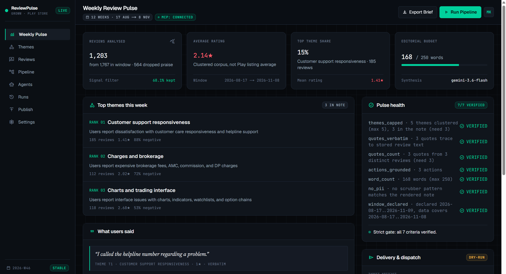
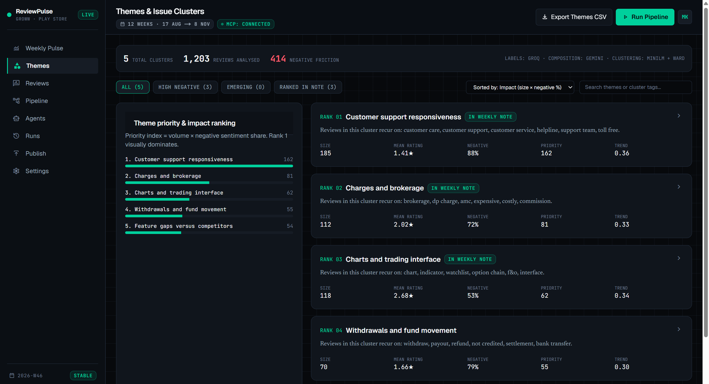
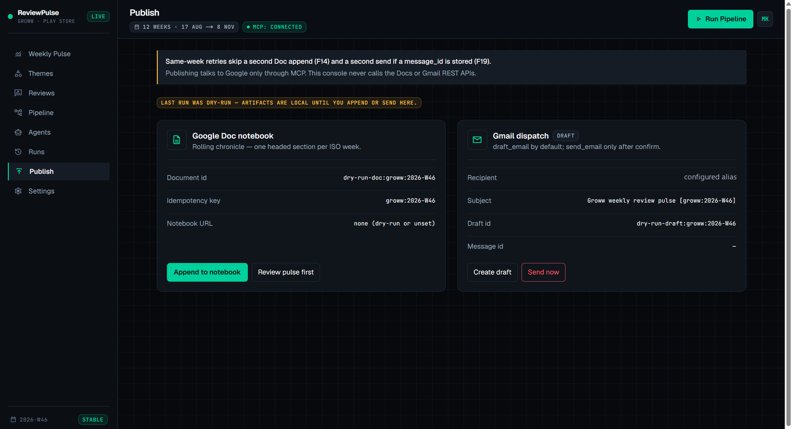
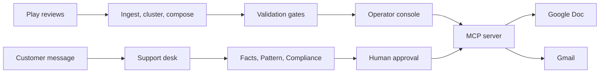

# Groww Review Intelligence

Weekly product pulse from public Groww Play Store reviews, and a support desk that drafts customer replies and holds investment advice until a person approves the exact text.

**[Manoj Kumar Sah](https://github.com/Manojkr6637)** · [GitHub](https://github.com/Manojkr6637) · [LinkedIn](https://www.linkedin.com/in/manoj-kumar-sah/)

|         |                                                                                                         |
| ------- | ------------------------------------------------------------------------------------------------------- |
| Console | [reviewpulse-web-production-836a.up.railway.app](https://reviewpulse-web-production-836a.up.railway.app) |
| Source  | [manojkr-ai-labs/grow-review-aiagent-mcp](https://github.com/manojkr-ai-labs/grow-review-aiagent-mcp)    |
| Demo    | [YouTube](https://youtu.be/g9l3bPOxHKQ)                                                                  |

| Window          | Reviews clustered | Validation | Support-desk tests |
| --------------- | ----------------- | ---------- | ------------------ |
| 17 Aug – 8 Nov | 1,203             | 7/7 gates  | 138 passed         |

## What it does

Product, support, and leadership get one page each week: at most five themes, the top three, three verbatim quotes, and three actions tied to those themes. The note stays within 250 words. It is appended to an existing Google Doc and delivered by Gmail. Google access stays inside a hosted MCP server. This service calls MCP tools only.

The support desk handles one customer message with three agents — facts, pattern, and compliance. Compliance redacts PAN, Aadhaar, account numbers, Indian mobile numbers, email, and OTP before the other agents run. Advice requests are refused. A Doc append and a Gmail draft run only after a person approves one reply hash. Weekly pulse publish uses a separate state file and can send mail. The desk creates drafts only.

## Product







Demo: [YouTube](https://youtu.be/g9l3bPOxHKQ)

Support-desk walkthrough: `docs/project-3/multi-agent-support-desk-demo.mp4`

## Architecture



Pulse design: `docs/architecture.md`. Support desk: `docs/project-3/architecture.md`. Credentials live in [mcp-gmail-google-docs-connect](https://github.com/manojkr-ai-labs/mcp-gmail-google-docs-connect).

## Engineering decisions

| Decision                                         | Why it matters                                                                        |
| ------------------------------------------------ | ------------------------------------------------------------------------------------- |
| Quotes are slices of stored review text          | The verbatim gate is an exact substring check. The model never authors a quote.       |
| Seven gates sit between synthesis and publish    | A failed note is kept as `note.rejected.md` and left unpublished.                   |
| PII is removed before anything is stored         | Reviewer names are dropped at download. Later stages see scrubbed text only.          |
| Clustering is numeric; the LLM only names themes | Theme count is a hard cap. Keyword labels cover a missing or rejected model output.   |
| Labeling and composition use different providers | Groq names themes. Gemini writes the note. One provider outage degrades one stage.    |
| Same-week publish is idempotent                  | A repeated ISO week does not append the Doc again, and a sent week is not sent twice. |
| Support publish requires an approved reply hash  | The desk and the weekly pulse do not share publish state.                             |

## Stack

| Layer         | Choice                                                                         |
| ------------- | ------------------------------------------------------------------------------ |
| Runtime       | Python 3.11+, CLI `reviewpulse`                                              |
| Orchestration | LangChain                                                                      |
| Theme labels  | Groq `openai/gpt-oss-120b`                                                   |
| Pulse prose   | Gemini `gemini-3.6-flash`                                                    |
| Clustering    | sentence-transformers, scikit-learn (MiniLM, Ward)                             |
| Store         | SQLite plus per-run JSON under `runs/`                                       |
| Google        | MCP Streamable HTTP: `append_to_google_doc`, `draft_email`, `send_email` |
| Console       | Next.js and FastAPI                                                            |
| Tests         | pytest, Playwright smoke                                                       |

Either model key can be absent. That stage uses its deterministic path and records the fallback on the run.

## Run

```bash
python -m venv .venv
.venv\Scripts\activate          # Windows
pip install -e ".[dev,web]"

cp config/settings.example.toml config/settings.toml
cp .env.example .env            # GROQ_API_KEY, GEMINI_API_KEY, MCP_AUTH_TOKEN
```

`MCP_AUTH_TOKEN` authorizes the hosted MCP server. Create the Google Doc in the account that authorized that server, then set `mcp.gdocs.document_id`. Default app is `com.nextbillion.groww`.

```bash
reviewpulse run --dry-run --window-weeks 12   # local note, no Google calls
reviewpulse mcp-check                         # tools and auth, before any model call
reviewpulse run --window-weeks 12             # Doc append and Gmail draft
reviewpulse run --send --window-weeks 12      # append, then send
reviewpulse schedule --once                   # weekly job: fetch, pulse, Doc, send
```

Operator console, from a second terminal after `reviewpulse serve` (API on `127.0.0.1:8000`):

```bash
cd web
npm install
npm run dev                      # http://127.0.0.1:3000
```

`reviewpulse --help` covers `fetch`, `ingest`, `cluster`, `pulse`, and `export`. A live run checks MCP tool names before it downloads reviews or calls a model. If the Doc append succeeds and Gmail fails, the notebook id is kept so the next attempt does not duplicate the section.

## Validation

Any failed gate aborts the run.

| Gate                 | Rule                                                 |
| -------------------- | ---------------------------------------------------- |
| `themes_capped`    | At most 5 themes clustered, exactly 3 in the note    |
| `quotes_verbatim`  | Each quote is a substring of its stored review       |
| `quotes_count`     | Exactly 3 quotes, from distinct reviews              |
| `actions_grounded` | Exactly 3 actions, each citing a real `theme_id`   |
| `word_count`       | At most 250 words in the rendered note               |
| `no_pii`           | Scrubber patterns find nothing in the final artifact |
| `window_declared`  | The note window matches the data actually used       |

PII and verbatim-quote failures abort immediately. Word count, quote count, and action grounding get one bounded retry.

```bash
pytest
python -m pytest tests/supportdesk -q
```

## Weekly job

`reviewpulse schedule --once` fetches new public reviews, classifies the rolling 8–12 week window, validates the note, appends the Doc, and sends mail. Overlapping runs take `data/schedule.lock` and exit cleanly. The database, embedding cache, and `data/publish-state.json` need a persistent disk. Default slot is Monday 09:00 `Asia/Kolkata`. Point cron or Task Scheduler at that command.

## Layout

| Path                 | Role                                           |
| -------------------- | ---------------------------------------------- |
| `src/reviewpulse/` | Ingest, cluster, pulse, publish, schedule, API |
| `src/supportdesk/` | Facts, pattern, compliance, approval           |
| `web/`             | Operator console                               |
| `tests/`           | Unit, contract, and support-desk tests         |
| `config/`          | Settings and theme taxonomy                    |
| `docs/`            | Architecture and support-desk design           |

Each run writes `runs/<run_id>/` with `clusters.json`, `note.md` or `note.rejected.md`, `publish.json`, and `manifest.json`. Support publish state is `data/supportdesk-publish-state.json`.

## Capstone

Architecture: `docs/capstone/architecture.md`.

The weekly loop and the desk loop stay separate, then meet in the question log. A pulse run writes `note.md` and `clusters.json`. After the pulse gates pass, one job calls `capstone.assemble` and stops at `package.json`. That file holds the hash of `note.md`, `explainer.json`, and `support_signals.json`. A person approves that hash before a package publish. The desk takes one customer message through facts, pattern, and compliance, then waits for approval of the reply hash on screen. Five identical sanitized questions in the same week become one queue signal. Questions the corpus does not cover become the explainer's last bullet. A review theme is pattern evidence. It is not a fact about a fund.

Sources:

| Source | What it supplies |
| --- | --- |
| Play Store export and `clusters.json` | Theme labels, review ids, and pattern counts |
| `SUPPORTDESK_PROJECT1_ROOT` | The Milestone 1 public Groww page index used for factual claims. The ten official URLs are listed in `docs/source-manifest/README.md`. |
| `data/capstone.db` | The question log and the not-covered ledger |

`SUPPORTDESK_PROJECT1_ROOT` points at the sibling FAQ catalog. If that catalog is missing, facts stay not covered. The code does not invent a passage. `data/capstone.db` is gitignored.

C1 checks a covered fact: at most three sentences, one allow-listed link, and a last-checked date or the word unavailable. C2 checks a question the corpus does not support: not covered, pages searched named, no guessed claim, and a ledger row. C3 asks one charge question five times against a fee theme and checks the routing note, the queue line, and the six-bullet ceiling. C4 checks that a phone number is absent from the response, the log, and the stored case. C5 refuses an advice question and the follow-up on the same session, and a draft that fails review twice is blocked with no Docs or Gmail call.

Recorded results are in `docs/capstone/evals-report.md` (golden set, adversarial cases, and scores) and `docs/capstone/eval.md`. Run the checks with:

```bash
python -m pytest tests/capstone -q
```

E1, E2, and E3 are `tests/capstone/test_eval.py`. C1–C5 are `tests/capstone/test_scenarios.py`.

Package publish records attempts in `data/publish-state.json`. Desk publish records attempts in `data/supportdesk-publish-state.json`. The desk path drafts mail and does not send it. The package path may send only when the approved action says send. The hosted MCP server is not exactly-once. This service does not claim exactly-once execution. The state files only stop this process from repeating a call it already recorded.
