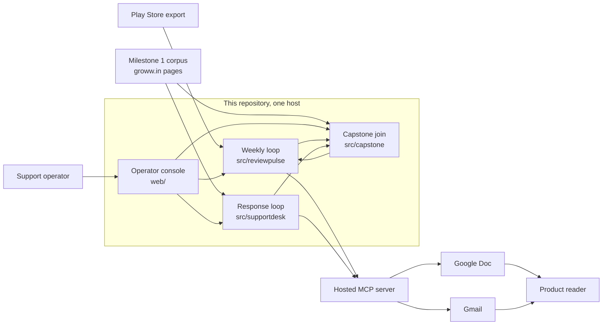
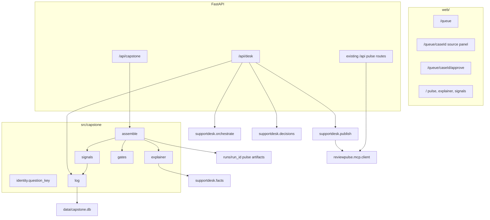
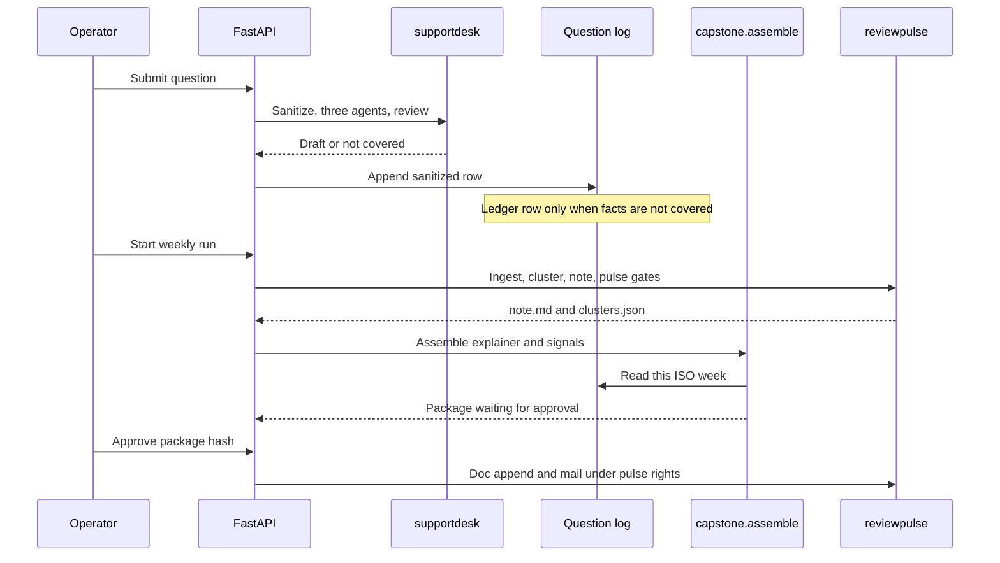

# Architecture — The Support Desk

Companion to `docs/capstone/ProblemStatements.md`. That document defines what the assembled system must do. This document defines how this repository does it.

Requirement ids (W, R, J, G, P, A, B, S, C, E) refer to that problem statement. This file does not reopen Milestone 2 or Milestone 3.

This is the target architecture. Inherited modules exist today. Capstone modules are the layer this design adds. Nothing in those new modules is a claim that the join, the explainer, or the queue screens are already shipped.

| | |
| --- | --- |
| Product | Groww — Stocks, Mutual Fund, IPO (`com.nextbillion.groww`) |
| Runtime | Python 3.11, FastAPI, the existing Next.js console |
| Pulse design record | `docs/architecture.md`, implemented in `src/reviewpulse/` |
| Desk design record | `docs/project-3/architecture.md`, implemented in `src/supportdesk/` |

## 1. Drivers

| Driver | Architectural consequence |
| --- | --- |
| Three evidence types stay distinct (factual, pattern, queue) | No component may write a queue count into a citation, or a review count into a fact. Labels travel with the data. |
| Milestones are inherited, not rebuilt | `src/reviewpulse/` and `src/supportdesk/` keep their public behavior. The capstone calls them. |
| A person approves one exact version (B1, B2) | Two approval hashes, two state files, two mail rights. |
| The model stops where retrieval stops (G4, J5) | Facts come from `retrieve_for_question`. Joins are counts over stored rows. |
| One deployed app (section 8) | New HTTP routes mount on the existing FastAPI app. New pages mount on the existing console. |
| The hosted MCP server is not exactly-once (B6) | Timeouts stay `uncertain` and are not retried. The README states the limit. |

## 2. System context

OAuth and Google's HTTP API stay inside the MCP server. This repository calls `append_to_google_doc`, `draft_email`, and, for the weekly pulse only, `send_email`.

## 3. Containers and module boundaries

| Container | Owns | Must not own |
| --- | --- | --- |
| `src/reviewpulse/` | Ingest, cluster, 250-word note, pulse gates, pulse publish state | Question identity, the ledger, desk approval |
| `src/supportdesk/` | Sanitize, three agents, reviewer, desk approval hash, desk publish | Weekly theme clustering, pulse send |
| `src/capstone/` | Question key, question log, not-covered ledger, support signals, fee explainer, weekly package hash | A second facts agent, a second redactor, a second MCP client |
| `reviewpulse.api` | HTTP for both loops. Capstone routes are included, not a second process | Business rules copied out of the packages above |
| `web/` | Queue, source panel, pulse, approval screens | Direct MCP calls or direct corpus reads |

### 3.1 Inherited call paths

These stay as they are documented in the desk architecture.

| Step | Call | Rule |
| --- | --- | --- |
| Facts | `supportdesk.facts.answer_facts` → Project 1 `retrieve_for_question` and `load_index` | Do not call Project 1 `ask()`. Missing root or empty index is an agent error or `not_covered`. |
| Pattern | `supportdesk.pattern.answer_pattern` | Reads `data/exports/play_store.csv` and `runs/<run_id>/clusters.json`. Does not re-cluster. |
| Compliance | `supportdesk.compliance` then `supportdesk.privacy.redact_pii` | Redact before any other agent sees the text. |
| Parallelism | `supportdesk.orchestrate.orchestrate` | `asyncio.gather`. Start and end times are the R3 evidence. |
| Desk review | `supportdesk.reviewer.review_case` | One rework, then `blocked`. |
| Desk decision | `supportdesk.decisions.decide` | Hash from `supportdesk.approval.content_hash`. |
| Desk write | `supportdesk.publish.publish_case` | `append_to_google_doc` and `draft_email` with `refuse_send_tool(..., allow_send=False)`. |

Approved hosts remain `groww.in` and `www.groww.in`, HTTPS only. `SUPPORTDESK_PROJECT1_ROOT` overrides the sibling `mutual-fund-faq-assistant` checkout.

## 4. The two loops and the join

A desk rejection does not call `assemble`. The explainer file from the last assemble stays byte-for-byte the same (E2). Ledger rows accumulate for the next assemble. They do not rewrite an approved or pending package.

### 4.1 Question identity [Derived]

`src/capstone/identity.py` is the only place that decides two questions are the same. The model is not called.

The key is computed on sanitized text:

1. Unicode NFKC, then casefold.
2. Remove redaction placeholders (`[pan]`, `[aadhaar]`, `[account]`, `[phone]`, `[email]`, `[otp]`). Two customers who asked the same thing with different personal data share one key, and the key contains none of that data.
3. Replace every character that is not a letter or digit with a space. Collapse whitespace.
4. If the result is empty, store `question_key` as empty and exclude the row from the five-times count. Empty keys must not merge into one signal.

Equality is exact string equality of that key. No stemming, no embeddings, no synonym list.

### 4.2 The pulse week [Derived]

The five-times window is the ISO week of the run in `Asia/Kolkata`, formatted `YYYY-Www`. That is the same week identity the pulse publish state already uses, without the `groww:` prefix.

It is not the 8–12 week review lookback. Review counts and question counts use different windows and must be labeled with their own dates on screen.

### 4.3 Five-times signal (J2)

`src/capstone/signals.py` groups log rows by `(week_id, question_key)` and keeps groups whose count is at least 5 and whose key is non-empty.

Each signal is a stored record, not a sentence written by a model:

| Field | Source |
| --- | --- |
| `week_id` | The row |
| `question_key` | `identity.question_key` |
| `count` | Number of log rows in the group |
| `case_ids` | The case ids in that group, sorted |
| `theme_id` | Present only when every row in the group shares one matched theme id. Otherwise null |
| `evidence_type` | The constant `queue` |

The pulse screen and the Google Doc section render this fixed template, filled only with those fields:

`Support was asked "{question_key}" {count} times in {week_id}. This line is the question log, not review volume.`

Review volume cannot create a row in this list. A pattern signal on a single routing note stays on that note and is labeled `pattern`.

### 4.4 Not-covered ledger (J3)

A log row is copied to the ledger when `facts_coverage` is `not_covered`. The ledger stores `case_id`, `sanitized_text`, `searched_urls`, `week_id`, and `theme_id` if the pattern agent matched one. `searched_urls` are the URLs the facts agent actually returned. An empty search list is stored as empty.

The explainer's last bullet is a render of these rows. Allowed forms:

- One or more rows: the bullet contains each `case_id` and the sanitized question, copied from the ledger. The source panel lists the searched URLs.
- No rows: the exact sentence `No queued question in this week was outside the corpus.`

The explainer must not describe a gap that has no ledger row.

### 4.5 Fee theme and explainer (W1, W2)

Fee-theme selection reads `runs/<run_id>/clusters.json`. A theme is a fee theme when its label or keywords contain one of: `fee`, `fees`, `charge`, `charges`, `brokerage`, `exit load`, `expense ratio`, `demat`, `amc`, and its measured member count is at least the desk's recurring floor (3). The largest such theme wins. If none qualify, the package records `fee_theme: null` and the pulse screen states that no fee theme met the bar. The assembler does not invent a theme id.

Factual bullets call `supportdesk.facts.answer_facts` on a fixed ordered list of fee questions: exit load, expense ratio, and other fee questions already in the Milestone 1 catalog. A bullet is kept only when coverage is `covered`, the claim is a substring of the retrieved passage, and the URL is allow-listed. Bullets stop at five links. A not-covered retrieval does not become a factual bullet.

The sixth bullet is the ledger bullet from section 4.4. The explainer therefore has at most six bullets and at most five official links (S3, W2).

A deterministic scan rejects a bullet that contains advice, a buy or sell instruction, a return figure, or personal data. Failure blocks the weekly package. It does not publish a shorter model rewrite.

### 4.6 Disagreement (J4)

Already enforced inside `supportdesk.orchestrate` and `supportdesk.reviewer`: the customer reply cites the fact, and the routing note keeps a `recurring` or `rising` signal, the count, and the window. The capstone adds one projection. When that case's question key also meets J2, the support signal in the weekly package retains the pattern fields copied from the stored pattern result: signal, count, and window. The customer draft is not edited to mention the count.

## 5. Weekly package

The Milestone 2 note stays `runs/<run_id>/note.md` and remains subject to the existing seven gates, including `word_count` at 250 (S2). Support signals are not inserted into that note. Putting them there would spend the word budget on queue evidence and would let a model rewrite a count.

The weekly package is three files under the same run directory:

| File | Writer | Contents |
| --- | --- | --- |
| `note.md` | `reviewpulse` | The pulse. Unchanged contract. |
| `explainer.json` | `src/capstone/explainer.py` | At most six bullets, source links, ledger citation |
| `support_signals.json` | `src/capstone/signals.py` | J2 rows for this `week_id`, or an empty list |

`src/capstone/package.py` hashes the exact bytes of all three with a fixed JSON encoding (`sort_keys`, compact separators, UTF-8). Approval of the weekly package binds to that hash (B2, W4). Replacing any file clears approval.

One trigger (W3) is the existing console pipeline action, extended with a single trailing step: after pulse gates pass, call `capstone.assemble.run(run_id)`. Assemble does not call MCP. The run then waits on the approval screen.

`reviewpulse run --send` remains the Milestone 2 command. The capstone path does not route through it. Desk approval never sets the pulse state file, and pulse approval never sets the desk state file (B4).

| Path | State file | Tools | Send |
| --- | --- | --- | --- |
| Desk case | `data/supportdesk-publish-state.json` | `append_to_google_doc`, `draft_email` | Never |
| Weekly package | `data/publish-state.json` | `append_to_google_doc`, `draft_email`, `send_email` | Only after the package hash is approved |

Idempotency keys for a desk case stay `desk:<case_id>:<digest prefix>:docs_append` and the matching `gmail_draft` key. A succeeded action is skipped. A timeout is `uncertain` and is not retried. A definite failure may be retried. The hosted server has no update-draft tool, so a non-timeout draft retry can create a second draft. That limit is printed on the approval screen and in the README (B5, B6).

## 6. Persistence

`data/capstone.db` is SQLite, gitignored on the same policy as `data/reviews.db`. The schema has three tables and no raw-message column (J1, P1).

`question_log`

| Column | Rule |
| --- | --- |
| `case_id` | Primary key. `case_` plus 32 hex characters |
| `week_id` | `YYYY-Www` in Asia/Kolkata |
| `question_key` | Output of `identity.question_key`, may be empty |
| `sanitized_text` | Text after redaction |
| `facts_coverage` | `covered` or `not_covered` |
| `searched_urls` | JSON list copied from the facts result |
| `theme_id` | Null unless the pattern agent matched one |
| `created_at` | Timezone-aware timestamp |

`not_covered_ledger`

| Column | Rule |
| --- | --- |
| `case_id` | Primary key, also a foreign key to `question_log` |
| `week_id`, `sanitized_text`, `searched_urls`, `theme_id` | Copied from the log row in the same transaction |

`desk_cases`

| Column | Rule |
| --- | --- |
| `case_id` | Primary key. `case_` plus 32 hex characters |
| `payload` | Sanitized JSON of the Milestone 3 case object |
| `updated_at` | Timezone-aware timestamp |

The raw customer message is not a column, not a log field, and not an agent argument. If `redact_pii` cannot guarantee redaction, the desk blocks the case and the capstone writes nothing (P2).

Desk workflow state continues to live in the Milestone 3 case object. This database does not become a second approval store. Approval records stay with `supportdesk.decisions` and the weekly package hash stays beside the run directory.

## 7. HTTP interface

Routes are added to the existing FastAPI application. They return the stored contracts. They do not accept a citation, a count, or a coverage flag from the client (J5).

| Method and path | Behavior | Requirement |
| --- | --- | --- |
| `POST /api/desk/questions` | Sanitize, orchestrate, review, append the log | R1–R3, J1, J3 |
| `GET /api/desk/queue` | Pending, blocked, and rejected cases. Sanitized text only | R1 |
| `GET /api/desk/cases/{case_id}` | Draft, routing note, agent timings, claims, reviewer findings | R2, R3 |
| `POST /api/desk/cases/{case_id}/refine` | At most five rounds. Re-review. Hash changes | R4 |
| `POST /api/desk/cases/{case_id}/decision` | Approve or reject the current hash | R4, B2 |
| `POST /api/desk/cases/{case_id}/publish` | `publish_case` only when the hash matches and state allows MCP | B1, B3, R5 |
| `POST /api/capstone/runs/{run_id}/assemble` | Build explainer and signals after pulse gates | W1–W3 |
| `GET /api/capstone/runs/{run_id}/package` | Note, explainer, signals, package hash, ledger rows | W2, J2, J3 |
| `POST /api/capstone/runs/{run_id}/decision` | Approve or reject the package hash | W4, B2 |
| `POST /api/capstone/runs/{run_id}/publish` | Pulse publish tools only, for that hash | B4 |

`POST /api/desk/cases/{case_id}/publish` calls `refuse_send_tool` with send disabled. It has no request field that can turn send on.

Rejecting a desk case returns the case to the queue and does not open `explainer.json` (R4, E2).

## 8. Operator console

New pages use the existing AppShell. The pulse page gains two blocks. It does not lose the themes, quotes, or publish flow.

| Route | What the operator sees | Intent treatment |
| --- | --- | --- |
| `/queue` | Sanitized question, draft or not covered, citation, reviewer flag, state | Chips below |
| `/queue/[caseId]` | Reply, routing note, source panel, agent start and end times | Source panel shows claim, link, last-checked date, or the pages searched |
| `/queue/[caseId]/approve` | Exact reply, exact routing note, Doc destination, Gmail draft recipient, content hash. States that send will not be called | Approve and reject apply to the hash on screen |
| `/` | Existing pulse, then the explainer, then support-signal lines | Each signal is labeled `queue`. Pattern counts on a theme stay labeled `pattern` |
| `/publish` | Existing pulse publish, extended so the approved body is the weekly package | Package hash shown before the write |

Intent chips are derived from stored fields, in this order, and every chip that applies is shown:

| Chip | Condition |
| --- | --- |
| Personal data | Compliance recorded a redaction, or the case was blocked because redaction could not be guaranteed |
| Advice | Compliance decision is a refusal for advice or a return request |
| Complaint | Pattern signal is `recurring` or `rising` and `theme_id` is set |
| Fact | Facts coverage is `covered` |
| Not covered | Facts coverage is `not_covered` |

A fact chip and a complaint chip together are the J4 disagreement, shown as two chips rather than one blended label.

Last-checked date on the source panel comes from the chunk `retrieved_on` value the facts agent already stores. If it is missing, the panel says the date is unavailable (G5).

## 9. Failure behavior

| Condition | Result |
| --- | --- |
| Project 1 root missing or index empty | Facts agent error or `not_covered`. No general-knowledge answer. Assemble writes no factual bullet for that question. |
| Pattern artifacts missing | Pattern status `insufficient_data`. The routing note says so. J2 can still fire from the question log. |
| Redaction cannot be guaranteed | Case `blocked`. No log row. |
| Second reviewer failure | Case `blocked`. Publish route returns an error. No MCP call. |
| Desk Doc append succeeds and Gmail fails | Desk state `partial_failure`. Retry drafts only. Append is not repeated. |
| MCP timeout | Status `uncertain`. No automatic retry. |
| Assemble finds no fee theme | `fee_theme` is null. The pulse screen says the bar was not met. |
| Ledger empty | Last explainer bullet is the empty-ledger sentence. |
| Client sends a citation or a count | Ignored. The response is computed from stored agent output and the log. |

## 10. Evaluation placement

| Check | Where it runs |
| --- | --- |
| C1, C2, C4, C5 | `tests/capstone/` against the desk API and the log, plus the existing `tests/supportdesk` suite |
| C3 | A fixture week with five identical sanitized keys and one `clusters.json` fee theme. Assert the signal file, the routing note, and a six-bullet ceiling |
| E1 | One assemble on a fixture run. Assert every queued case is drafted or not covered, theme ids are present, word count and bullet count hold, and MCP was not called |
| E2 | Approve hash A, attempt to publish hash B, expect a refusal. Reject a case and hash `explainer.json` before and after |
| E3 | Five stored claims with link, passage, and review id where the pulse is involved. Then PAN, account number, phone, and a return-figure request through `POST /api/desk/questions` and through assemble input. Assert no publish-state change |

Results are written to `docs/capstone/eval.md` with the command, the date, and pass or fail. A check not executed is recorded as not run.

The Milestone 1 catalog is a bounded public-page index. A high not-covered rate on Play Store complaints is the correct E1 outcome when C1 still passes for a question inside the catalog.

## 11. Deployment

The hosted shape stays the current Railway split: FastAPI (`main.py`) and the Next.js console. Capstone routes ship inside the API image. The console image only needs the new pages.

The API host needs the Project 1 corpus available at `SUPPORTDESK_PROJECT1_ROOT`, or facts will correctly return not covered. `data/capstone.db` lives on the same persistent disk as `data/reviews.db` and `data/publish-state.json`.

Secrets remain `MCP_AUTH_TOKEN` and the model keys, supplied by the environment. The capstone database stores no tokens. Screenshots and the demo use sanitized fixtures.

## 12. Requirement map

| Id | Component that satisfies it |
| --- | --- |
| W1 | `reviewpulse` pulse, plus fee-theme selection in `capstone.explainer` |
| W2 | `capstone.explainer`, ledger bullet from `capstone.log` |
| W3 | Pipeline action, then `capstone.assemble`, no MCP inside assemble |
| W4 | Package hash in `capstone.package`, pulse publish route |
| R1 | `GET /api/desk/queue`, `/queue` |
| R2 | `supportdesk.orchestrate` draft and routing note |
| R3 | `asyncio.gather` timings on the case page |
| R4 | `supportdesk.decisions`, approval page |
| R5 | `supportdesk.reviewer`, publish route refuses `blocked` |
| J1 | `question_log` |
| J2 | `capstone.identity`, `capstone.signals` |
| J3 | `not_covered_ledger`, explainer bullet 6 |
| J4 | Desk orchestrator, copied onto the signal when J2 also matches |
| J5 | HTTP handlers ignore client-supplied evidence |
| G1–G5 | Facts agent, explainer gate, source panel |
| P1–P3 | `supportdesk.privacy` before the log write |
| A1–A4 | `supportdesk.advice` and `supportdesk.reviewer` |
| B1–B6 | Separate state files, hash binding, `refuse_send_tool`, uncertain timeouts |
| S1 | Desk reply contract |
| S2 | Existing pulse `word_count` gate, signals kept outside `note.md` |
| S3 | Explainer gate |
| S4 | Existing theme and quote gates |
| C1–C5 | Section 10 |
| E1–E3 | Section 10 |

## 13. What this design refuses to add

- A new agent framework, a new vector store, or a second retrieval stack.
- A capstone path that calls `send_email` for a desk case.
- A model call whose job is to decide that two questions match, that a theme is about fees, or that a missing count is zero.
- A merge of `data/publish-state.json` and `data/supportdesk-publish-state.json`.
- Changes to Milestone 2 or Milestone 3 acceptance criteria in order to make the join easier.
