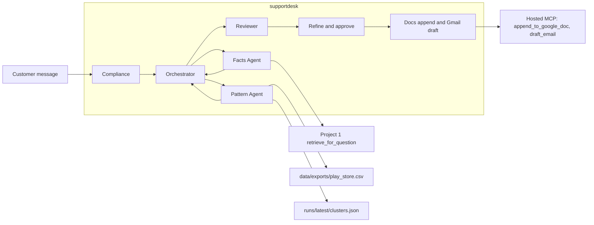
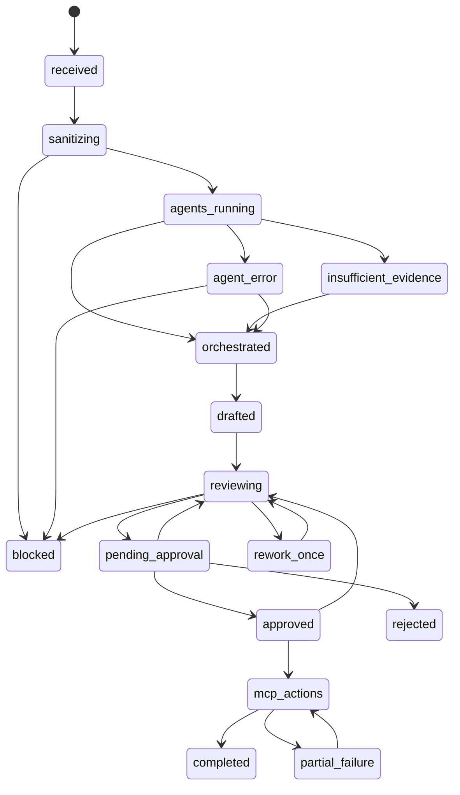

# Architecture — Multi-agent support desk

Project 3 lives in `src/supportdesk/` (package version 0.1.0). The weekly pulse stays in `src/reviewpulse/`. Pulse architecture remains `docs/architecture.md`. This document describes only the support desk.

The inspection that fixed these choices is `docs/project-3/repository-audit.md`. The phase log is `docs/project-3/implementation-plan.md`.

## 1. What the desk does

A customer message is redacted, then three agents run at the same time:

| Agent | Module | Input it is allowed to use | Output |
| --- | --- | --- | --- |
| Compliance | `supportdesk.compliance` | The message, then only the redacted text | `ALLOW`, `REDACT_AND_ALLOW`, `REFUSE`, or `BLOCK` |
| Facts | `supportdesk.facts` | Redacted text that was allowed | A claim copied from Project 1 retrieval, or `not_covered` |
| Pattern | `supportdesk.pattern` | Redacted text, including a refused advice ask | `recurring`, `rising`, `one_off`, or `insufficient_data` |

`supportdesk.orchestrate.orchestrate` starts all three with `asyncio.gather` and `asyncio.to_thread`. Each agent gets a copy of the compliance session. The customer reply is at most three sentences. The routing note keeps team, priority, reason, pattern signal, count, and window. A cited fact and a recurring or rising pattern both stay visible.

The reviewer (`supportdesk.reviewer`) checks the draft once. One repairable failure is redrafted from the stored agent results. A second failure blocks the case. A person may refine the pending draft at most five times (`supportdesk.decisions`). Approve and reject apply to the hash of that reply and routing note. `supportdesk.publish.publish_case` appends a Google Doc and creates a Gmail draft only after that approval.

There is no support-desk CLI and no new console page. Call the Python functions. `main.py` remains the ReviewPulse API.

## 2. Context



Facts calls `retrieve_for_question` and `load_index`. It does not call Project 1 `ask()`. The approved hosts are `groww.in` and `www.groww.in`, HTTPS only. The sibling checkout `mutual-fund-faq-assistant` is the default root. `SUPPORTDESK_PROJECT1_ROOT` overrides it. A missing root is an agent error. The desk does not answer from general knowledge.

Pattern counts theme members in the filtered export. Theme membership comes from the latest `runs/<run_id>/clusters.json`. Period counts in `cluster_debug.json` are recorded and are not the rising test. Rising requires early and late counts both above zero, and `round(late/early, 2) >= 1.5`. The split is the requested end minus four weeks. Late rows are strictly after that split. Project 2 `emerging` is ignored. The desk does not re-cluster and does not read the raw Play download.

An explicit `csv_path` or `run_dir` does not open `data/reviews.db` unless `db_path` is passed. The default path set does check the store when that file exists.

## 3. Workflow



`rejected` and `blocked` have no MCP edge. `completed` has no outgoing edge. A second call on a completed case returns the saved ids and does not call the tools.

MCP is legal only from `approved` or `partial_failure`, and the approval hash must match the current reply and routing note. Changing that content returns the run to `reviewing` and clears the approval.

Ids are `case_`, `run_`, `exec_`, and `sess_` plus 32 hex characters. They do not contain the message.

## 4. External writes

The pulse helpers `publish_document` and `create_or_update_draft` write a weekly title and subject, and the draft helper requires a pulse note. The support desk does not call them. It calls `append_to_google_doc` and `draft_email` through `ToolClient`, `bind_arguments`, `extract_id`, and `refuse_send_tool(..., allow_send=False)`.

`send_email` is never invoked. `allow_send` stays false.

Publish state is a separate JSON file. Tests pass a temporary path. The local name is `data/supportdesk-publish-state.json`. The pulse file `data/publish-state.json` is left to the weekly notebook. The support file stores action status and external ids. It does not store the reply.

Idempotency keys look like `desk:<case_id>:<digest prefix>:docs_append` and the same shape with `gmail_draft`. A succeeded action is skipped on retry. A timeout is stored as `uncertain` and is not retried, because the hosted write may already have landed. A definite failure such as `503` is `failed` and may be retried. If the append did not succeed, Gmail is not called. The hosted server has no update-draft tool, so a non-timeout draft retry can create a second draft.

The caller supplies an existing document id and a recipient. The desk does not create a Google Doc and does not read `config/settings.toml`.

## 5. Privacy

Redaction is `supportdesk.privacy`. It is separate from `reviewpulse.privacy.scrubber`. Categories are PAN, Aadhaar, account number, Indian mobile, email, and OTP. Placeholders are `[pan]`, `[aadhaar]`, `[account]`, `[phone]`, `[email]`, and `[otp]`. Twelve digits are treated as Aadhaar. Thirteen or more are an account. If the redacted text still matches, the text is withheld and the case is blocked.

`content_has_pii` scans the reply, routing note, claims, and pattern prose. It does not scan case, run, or execution ids. A hex id can contain ten digits.

The session stores a session id and two booleans: advice already requested, performance already requested. It does not store the message. A later “What do you think?” in that session is still a refusal. A later factual question stays allowed and is still not turned into a recommendation.

## 6. Tests and further reading

```bash
python -m pytest tests/supportdesk -q
```

Edge cases: `docs/project-3/edge-cases.md`. Measured 20-example run: `docs/project-3/eval.md`. How to try the two demo prompts: the Project 3 section of the root `README.md`.
